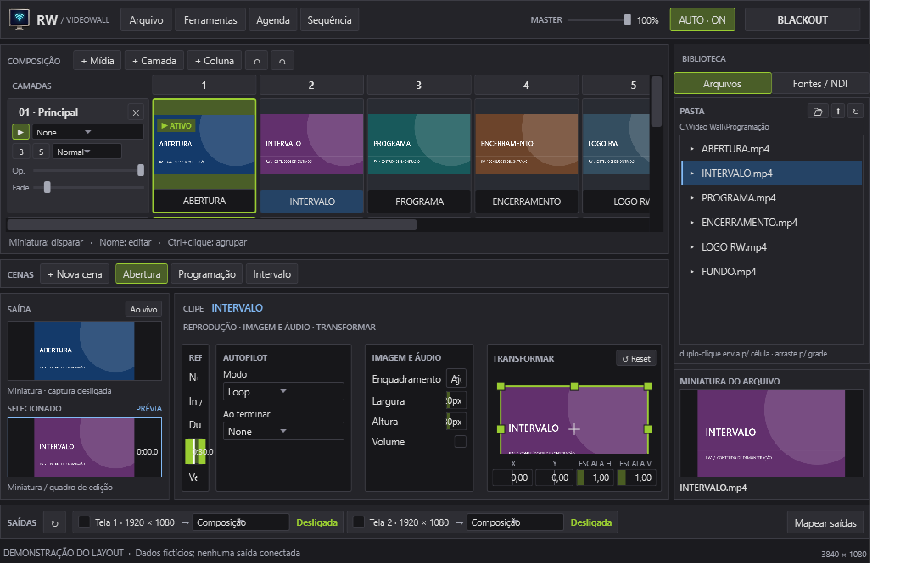
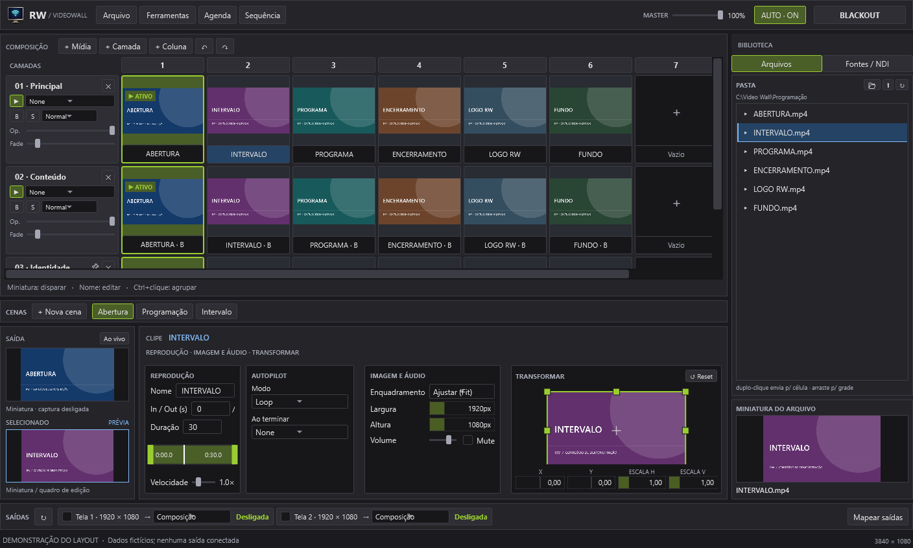

# Análise de consistência — VideoWallRW

Acompanhamento: os itens de implementação foram tratados na revisão subsequente. Consulte [a validação atual](UI-UX-VALIDACAO.md). Os achados abaixo registram o estado anterior às correções.

Data: 11/09/2026. Escopo: marca, layout, UI e UX do código atual do workspace.

## Conclusão

A estrutura de mesa de operação é coerente, mas a interface ainda não está consistente em todos os tamanhos e fluxos. A prioridade é corrigir o inspetor inferior: campos essenciais já ficam cortados no tamanho inicial de janela e quase desaparecem no tamanho mínimo. Há também divergências de unidades nos controles de dimensão e de linguagem visual entre seleção, operação e edição.

## Evidência e limites

Renderizei o XAML atual da janela principal com controles WPF reais e dados fictícios em janelas de 1440 × 900, 1100 × 720 e 1920 × 1080. As imagens registram o conteúdo da janela, sem sua moldura. O ensaio usou comandos inertes e não iniciou o motor nem ativou saídas de vídeo. A compilação e as três renderizações concluíram.

As janelas auxiliares foram avaliadas pelo código atual e pelas imagens de demonstração existentes; não foram todas renderizadas novamente. Não foram validados hardware, operação real, leitores de tela ou diferentes escalas de DPI.

As imagens e a descrição de abas em `UI-UX.md` representam uma versão anterior: o inspetor atual usa painéis simultâneos. A checagem visual antiga também pressupõe que `ClipInspector` seja um `TabControl`, mas agora ele é um `DockPanel`. Portanto, a aprovação antiga não comprova o layout atual.

## Achados por prioridade

### 1. Alta — Inspetor perde campos essenciais

Em 1440 × 900, o campo de saída do recorte (Out) fica cortado. Em 1100 × 720, nome, tempos, velocidade e parte dos controles de imagem ficam comprimidos ou ocultos. Em 1920 × 1080, os quatro blocos se acomodam melhor.

O inspetor tem três colunas proporcionais, e a primeira ainda reserva 175 unidades fixas para Autopilot. O espaço restante de Reprodução fica insuficiente; não há reorganização ou rolagem nesse conjunto.

**Recomendação:** manter os painéis simultâneos em larguras suficientes, mas reorganizá-los em duas linhas ou abas quando faltar espaço. Definir largura mínima útil por grupo e priorizar timeline, entrada/saída e velocidade.

Evidência: `src/VideoWallRW.App/MainWindow.xaml:554–576`.

### 2. Alta — Dimensão exibida e valor editável usam unidades diferentes

Largura e Altura mostram pixels, mas estão ligadas a ScaleX e ScaleY. O botão direito abre um campo com a escala bruta, por exemplo `1,00`, sem explicar a mudança de unidade. Digitar `1920` nesse diálogo resulta no limite de escala `4`, não em 1920 pixels. O título também fica genérico porque esses controles não recebem `Label`.

**Recomendação:** permitir entrada na mesma unidade apresentada; se o ajuste for escala, mostrar porcentagem e um rótulo explícito. Nomear os diálogos “Largura (px)” e “Altura (px)” quando houver conversão para pixels.

Evidência: `MainWindow.xaml:649–658` e `Controls/ValueSlider.cs:165–173`.

### 3. Média — Preparação e alteração da saída precisam de distinção mais explícita

A miniatura dispara, enquanto o nome seleciona. Essa distinção já tem uma instrução visível, o que ajuda. Porém, selecionar um clipe ativo e alterar seus parâmetros pode modificar imediatamente a saída. “PRÉVIA” é apenas miniatura/quadro de edição, não um ambiente de reprodução independente.

**Recomendação:** destacar “Editando clipe ativo — alterações afetam a saída” quando aplicável; manter um indicador de disparo sobre a miniatura. Usar “Quadro do clipe” para a prévia estática e identificar claramente quando a captura da composição está desligada.

Evidência: `MainWindow.xaml:507–546`; `ViewModels/GridViewModels.cs:385–439`.

### 4. Média — Verde tem significados demais

Verde representa clipe ativo, automação ligada, cena selecionada, aba da biblioteca, ação principal e alças de transformação. Azul representa seleção de arquivo/clipe e ferramenta do editor. Assim, duas seleções equivalentes recebem cores distintas.

**Recomendação:** azul para seleção/edição; verde para operação habilitada/ativa; vermelho para blackout/erro. Definir também o tratamento de botões primários, sem depender apenas da cor para comunicar sua função.

Evidência: `MainWindow.xaml:107–117, 377–381`; `Themes/Dark.xaml`; `Themes/Workspace.xaml`; `Themes/Auxiliary.xaml`.

Observação: o texto “Desligada” verde nas demonstrações é um valor fictício fornecido pelo ensaio. Em execução, o modelo pode fornecer texto vazio quando não há saída. Isso não foi tratado como um defeito confirmado de status real.

### 5. Média — Marca original e aplicação não formam uma identidade única

O arquivo “Logo RW VideoWall.png” contém a marca REMATE WEB, com acabamento metálico e símbolo de transmissão. O aplicativo usa outro desenho: monitor com Wi-Fi ciano, acompanhado de “RW / VIDEOWALL”. O ícone tem detalhes finos para sua aplicação em 26 × 26.

**Recomendação:** definir a relação entre marca principal e produto, padronizar a grafia e criar versões adequadas para ícone pequeno e assinatura completa. Preservar elementos reconhecíveis da identidade escolhida; não simplesmente reduzir a arte completa.

Evidência: arquivo original, `Assets/AppIcon.png` e `MainWindow.xaml:28–30`.

### 6. Média — Janelas e textos apresentam padrões diferentes

Agenda, editor e PDF usam `Auxiliary.xaml`, títulos de página e ações principais padronizadas. Saídas, instalação, atalhos e conversor mantêm o tema anterior. “Mapear saídas” abre uma janela chamada “Advanced Output”; a ajuda ainda cita “FILES” e “Avançado → Advanced Output”. Também coexistem “camada/layer”, “clipe/clip”, “Mute”, “Reset”, “None” e termos traduzidos.

**Recomendação:** aplicar os mesmos padrões de cabeçalho, seleção, espaçamento e ações às janelas restantes; atualizar ajuda e nomenclatura. Manter siglas técnicas úteis, como NDI e HAP, acompanhadas de descrição quando necessário.

O atalho Espaço foi rastreado até a implementação: ele alterna o autopilot global. Apesar do nome legado `ToggleMasterPause` e do comentário antigo no tratamento do teclado, não foi confirmado um erro funcional nesse atalho.

### 7. Média — Leitura e uso por teclado precisam de refinamento

Há vários textos de 9–10 unidades e comandos compactos como B, S e Op. Os controles de valor personalizados aceitam foco, mas não implementam ajuste por teclas ou indicação desenhada de foco, e a entrada exata depende do botão direito.

**Recomendação:** aumentar textos operacionais prioritários, explicitar abreviações quando houver espaço e acrescentar foco visível, ajuste por setas e entrada por teclado aos controles personalizados. Validar depois em DPI de 125%, 150% e 200%.

Evidência: `MainWindow.xaml:241–255, 693–709`; `Controls/ValueSlider.cs`.

### 8. Média — Entradas inválidas podem falhar silenciosamente

Se entrada, saída ou duração não puderem ser interpretadas, `ApplyEdits` retorna antes de aplicar inclusive outros parâmetros. A interface não apresenta um erro específico para esse caso. Isso pode fazer um ajuste parecer aceito visualmente sem chegar ao modelo.

**Recomendação:** validar junto ao campo, mostrar a unidade e a razão do erro, e evitar que um campo inválido bloqueie silenciosamente alterações independentes.

Evidência: `ViewModels/GridViewModels.cs:418–460`.

## O que está bem resolvido

- Grade ocupa a área principal, com biblioteca lateral e cenas próximas do conteúdo.
- Blackout permanece no topo e possui tratamento vermelho e texto de estado próprios.
- Seleção do clipe e clipe ativo têm diferenciação visual e selo textual.
- Divisores permitem ajustar o espaço entre as áreas.
- Editor de imagem e captura de banners têm hierarquia clara e ações de conclusão identificáveis nas imagens avaliadas.

## Ordem sugerida

1. Corrigir compressão do inspetor e unidades de Largura/Altura.
2. Melhorar validação de campos e indicação de edição do clipe ativo.
3. Unificar cores, textos, ajuda e janelas auxiliares.
4. Consolidar marca, ícones, legibilidade e navegação por teclado.

Nenhum código funcional do aplicativo foi alterado nesta análise. Foram criados apenas o ensaio isolado e os registros da auditoria.
