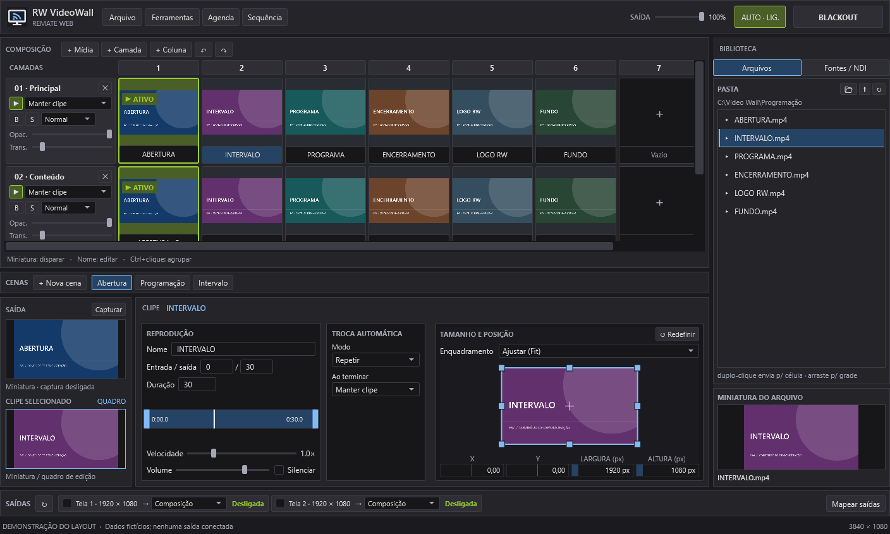
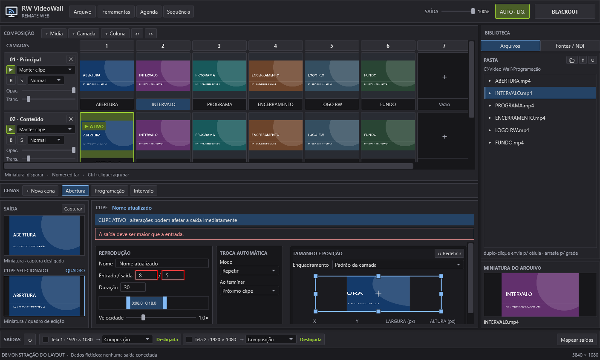
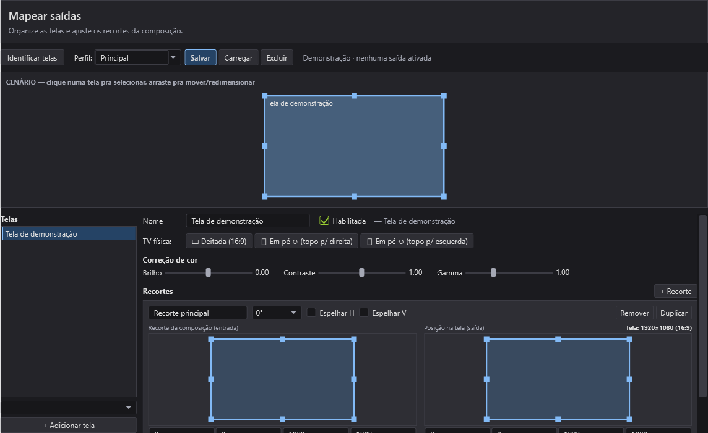
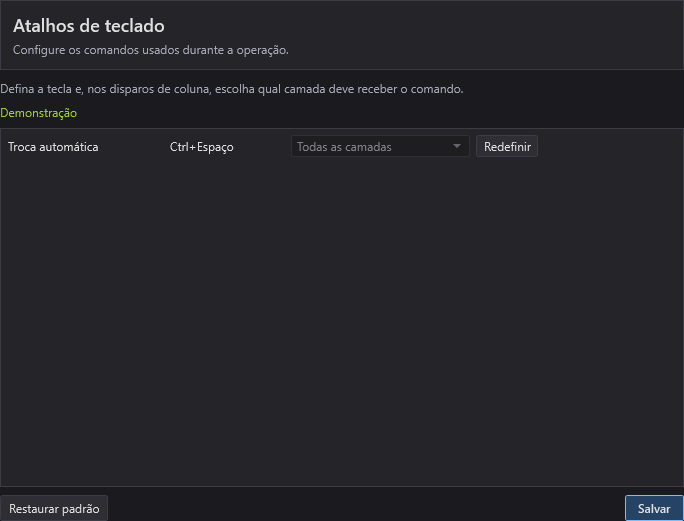

# RW VideoWall — revisão e validação de UI/UX

11/09/2026. Revisão solicitada após a auditoria de layout e a unificação de largura/altura.

## Entregue

| Área | Alteração |
| --- | --- |
| Marca | Assinatura RW VideoWall / Remate Web, símbolo vetorial de monitor e transmissão, ícones em 16, 24, 32, 48, 64, 128 e 256 px. Arte original preservada. |
| Tema | Recursos comuns para todas as janelas. Azul para seleção/edição e ações principais, verde para operação habilitada, vermelho para blackout e erros. |
| Organização | Reprodução e áudio junto dos tempos; enquadramento, posição e dimensões no mesmo painel; sem campos duplicados de escala. Rolagem protege os controles em espaços menores. |
| Textos | Rótulos de reprodução, atalhos e recortes em português, títulos e cabeçalhos padronizados, ajuda reescrita conforme o fluxo atual. Nomes internos e arquivos de projeto preservados. |
| Operação | Aviso ao editar clipe ativo; monitor estático identificado como quadro; captura da composição explicitamente separada da ativação das saídas. |
| Validação | Tempos inválidos indicados nos campos e em mensagem. Os últimos tempos válidos são preservados sem impedir volume, nome e transformação. Diálogo numérico informa erros e limites sem fechar. |
| Teclado | Foco visível, setas/Home/Enter/F2 nos controles de valor, setas no quadro de posição. Espaço preserva a ação nativa de botões e caixas em foco. |
| Acessibilidade | Nomes para comandos com símbolos, indicação de avisos, padrão acessível de intervalo numérico em pixels e notificações de mudança de valor. |
| Correções adicionais | Listas suspensas respeitam os rótulos de seus itens; edições do gizmo preservam ligações com o modelo; limites de transformação alinhados aos valores suportados. |

## Verificações concluídas

- Compilação do aplicativo durante os ensaios WPF, com avisos tratados como erros.
- **45 testes da solução aprovados:** 39 do núcleo e 6 da Agenda. Dois testes antigos foram adaptados às APIs atuais, mantendo a intenção das verificações: opacidade da cena em `Grid.MasterOpacity` e redimensionamento da grade por `SetColumnCount`.
- Janelas verificadas: principal, Agenda, editor de imagem, PDF, saídas, instalação, atalhos, conversor HAP, ajuda, entrada de valor e escolha de célula.
- Janela principal em 1440 × 900, 1100 × 720 e 1920 × 1080 unidades lógicas; controles acessíveis por rolagem na largura mínima. Inspetor com altura mínima de 300 unidades.
- Estados de seleção, clipe ativo, tempo inválido, blackout, ausência de seleção, carregamento/ausência de eventos e exportação simulada.
- Conversão de pixels para escala nos modos Ajustar, Preencher, Esticar e Original; vírgula decimal; sincronização bidirecional; rejeição de valores não finitos; limites.
- Controles WPF reais: validação dos campos, correção de erros, propagação de mudanças independentes, eventos de teclado, acesso por automação e manutenção das ligações do gizmo.
- Editor de imagem: seleção das ferramentas, recorte, alinhamento de camadas, expansão de tela, desfazer e zoom com mídia de demonstração.
- Renderizações da tela principal com densidades equivalentes a 100%, 125%, 150% e 200%. O texto dos controles de valor usa o DPI informado pelo WPF.

## Como repetir

Execute na raiz do repositório, em Windows com .NET Desktop:

```powershell
dotnet test VideoWallRW.sln
dotnet run --project tests/VideoWallRW.UiChecks/VideoWallRW.UiChecks.csproj
dotnet run --project tests/VideoWallRW.UiChecks/VideoWallRW.UiChecks.csproj -- --auxiliary
```

As imagens são gravadas em `artifacts/ui-review/`. O verificador usa dados fictícios e comandos externos inertes. Os testes de persistência existentes criam e removem presets com nomes exclusivos na pasta do aplicativo.

O ícone pode ser regenerado a partir de `Assets/Brand.xaml` executando, na raiz:

```powershell
pwsh -NoProfile -STA -File src/VideoWallRW.App/Assets/GenerateBrand.ps1
```

## Limites do resultado

Não foi iniciado um ensaio com o motor acionando telões, áudio ou fontes NDI reais. As renderizações em densidades diferentes não equivalem a alterar o DPI do Windows nem a testar movimentação entre monitores físicos. A janela principal ainda requer pelo menos 1100 × 720 unidades lógicas; em telas com escala alta, isso exige mais pixels físicos. Leitor de tela completo e operação prolongada continuam dependendo do equipamento e do ambiente de uso.

Essas limitações são de validação operacional: não representam alterações de interface deixadas por implementar nesta revisão.

## Imagens








