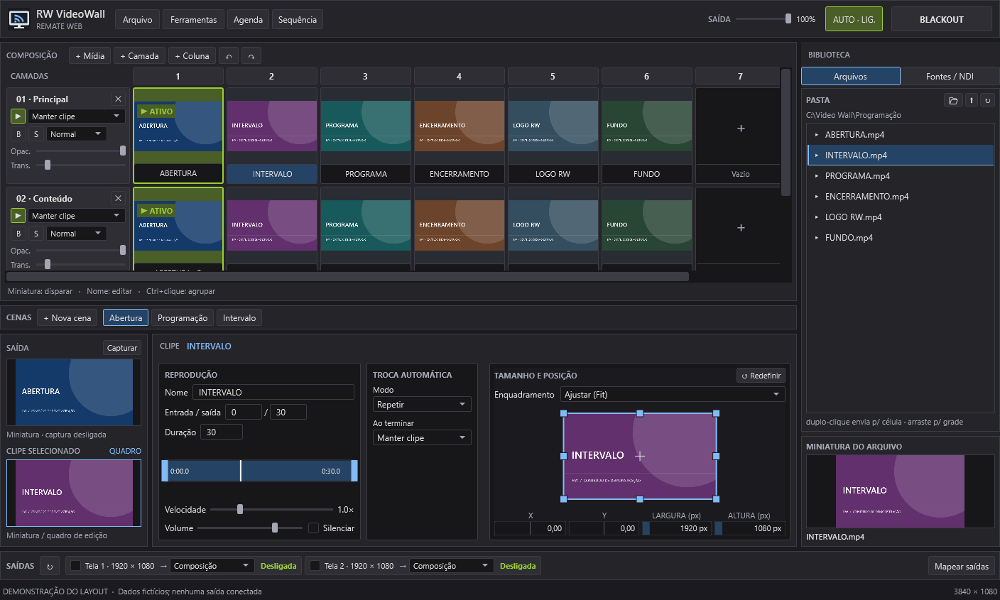
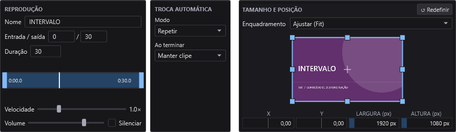
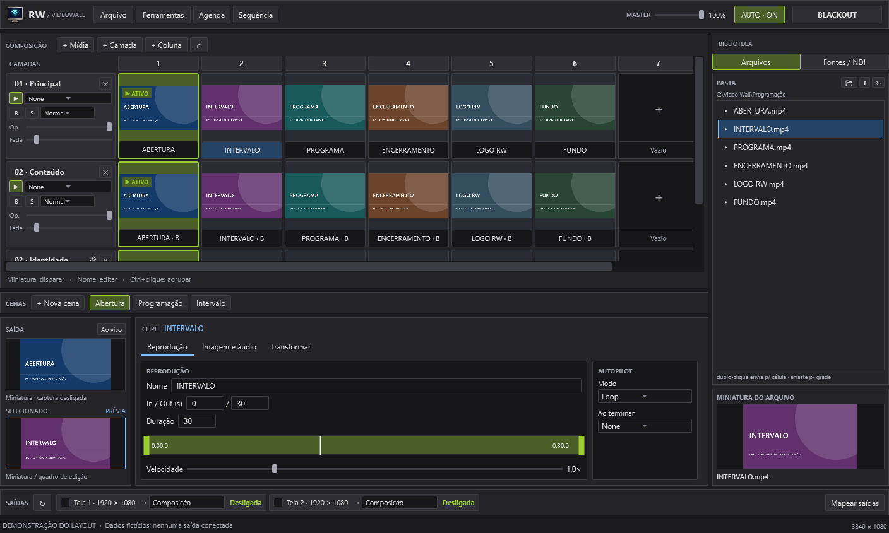
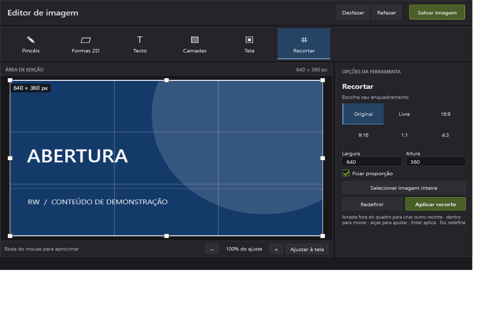
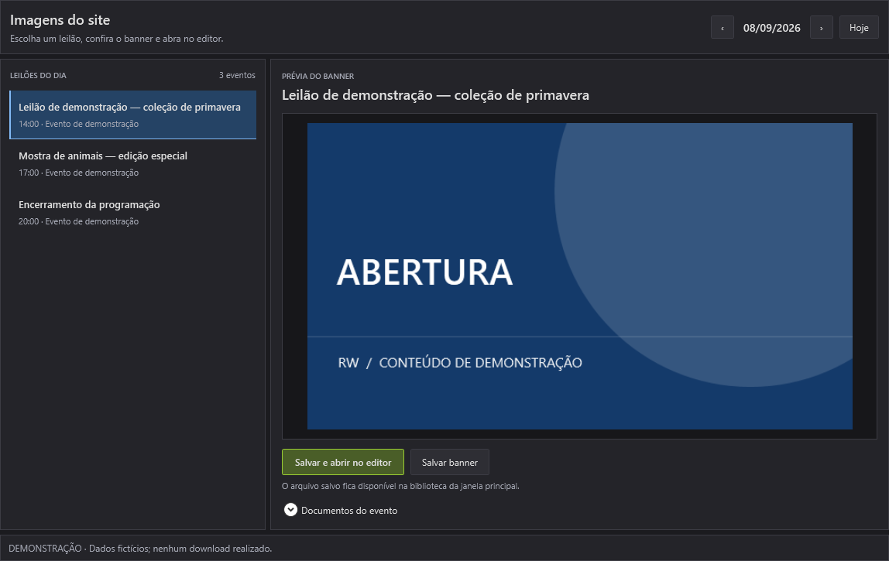

# RW VideoWall — mesa de operação

## Revisão consolidada — 11/09/2026

As alterações de interface da auditoria foram implementadas: marca Remate Web/RW VideoWall, ícone vetorial e versões para Windows, cores de seleção/operação, tema global das janelas, textos e ajuda, aviso de edição de clipe ativo, validação de tempos e entrada numérica, foco e ajustes por teclado. O inspetor de tamanho permanece unificado, sem campos duplicados de escala.



A suíte geral passou com 45 testes. O verificador WPF cobriu as 11 janelas, conversão de unidades, validação, teclado, acessibilidade dos controles de valor, três tamanhos de janela e renderizações em quatro densidades. Consulte [o registro de validação](UI-UX-VALIDACAO.md) para os comandos e limites dos ensaios. Operação física com telas, áudio e fontes reais não foi executada.

## Atualização de tamanho e posição — 11/09/2026

O inspetor atual reúne **Enquadramento, X, Y, Largura e Altura** no painel **Tamanho e posição**. Os campos duplicados de escala horizontal/vertical foram removidos da apresentação; a escala interna continua sincronizada com o editor visual e com os projetos existentes. Volume e Silenciar ficam junto da reprodução.



Largura e altura mostram pixels na composição, considerando o enquadramento escolhido antes da escala manual. O botão direito permite digitar na mesma unidade: informar 960 px sobre uma base de 1920 px produz escala interna de 0,5. Arrastar as alças atualiza os mesmos valores. Duplo-clique restaura a dimensão definida pelo enquadramento; Redefinir também centraliza a posição.

O inspetor tem dois grupos principais e largura mínima útil de 860 unidades. Em 1440 × 900 cabe sem rolagem; em janelas menores há rolagem para manter todos os campos acessíveis. Sua altura mínima é 300 unidades. Compilação e renderização verificadas em 1440 × 900, 1100 × 720 e 1920 × 1080; também verificadas conversões de pixels, ligação bidirecional com a escala, vírgula decimal e limites. Os ensaios usam dados fictícios e não ativam saídas reais.

As seções abaixo registram a implementação anterior, incluindo o inspetor em abas, e devem ser lidas como histórico.

## Histórico da mesa de operação

Layout implementado na janela principal, usando o Resolume Arena como referência de organização. A prioridade é manter grade, estado das saídas e comandos globais acessíveis durante a operação.



A imagem foi renderizada a partir do XAML e dos controles reais do aplicativo, com conteúdo de demonstração. Não representa uma transmissão ou conexão de hardware.

## Diagnóstico do projeto

O aplicativo já possui uma base WPF/MVVM e um motor de composição separado da interface. Camadas, colunas, cenas, arquivos, fontes NDI, automação, ajustes de clipes e roteamento de monitores já existem. A intervenção foi concentrada na apresentação desses recursos.

| Problema encontrado | Mudança implementada |
| --- | --- |
| Faixa inferior com quatro blocos simultâneos e larguras rígidas; pouco espaço para transporte | Inspetor com abas Reprodução, Imagem e áudio, Transformar |
| Monitores “Composition” e “Preview” ligados à mesma imagem | Saída ligada à composição; selecionado ligado à miniatura/quadro de edição do clipe |
| Grade disputando altura com os demais controles | Área de operação dividida por proporções e divisores redimensionáveis |
| Clipe carregado, ativo e selecionado com aparência semelhante | Mídia carregada neutra; ativo com borda verde e texto; seleção editorial azul |
| Biblioteca podia deixar parte da largura sem uso | Arquivos e fontes ocupam a mesma área central da biblioteca |
| Cenas e monitores sem acomodação para listas extensas | Rolagem horizontal e cenas posicionadas junto à grade |
| Exclusão de cena imediatamente ao lado de sua ativação | Exclusão permanece no menu de contexto |
| Template herdado podia aplicar verde ao blackout | Template específico com vermelho e “BLACKOUT · ATIVO” |
| Barras de rolagem e controles claros contrastando com a mesa escura | Estilos locais para barras, seleção e controles de valor |

## Estrutura

```text
┌───────────────────────────────────────────────────────────────┐
│ Marca · Arquivo · Ferramentas · Agenda · Sequência              │
│                                  Master · Auto · BLACKOUT     │
├─────────────────────────────────────────────┬─────────────────┤
│ COMPOSIÇÃO                                  │ BIBLIOTECA      │
│ Importar · Camada · Coluna · Desfazer        │ Arquivos / NDI  │
│                                             │                 │
│ Camadas × clipes; cabeçalho dispara coluna   │ Pasta / fontes │
│                                             │                 │
│ Cenas                                       │                 │
├─────────────┬───────────────────────────────┤                 │
│ SAÍDA       │ CLIPE SELECIONADO             │                 │
│ captura ou  │ Reprodução                    │                 │
│ miniatura   │ Imagem e áudio                │                 │
│             │ Transformar                   │ Miniatura do    │
│ SELECIONADO │                               │ arquivo         │
├─────────────┴───────────────────────────────┴─────────────────┤
│ SAÍDAS · ativação · roteamento · FPS · Mapear saídas           │
│ Estado do sistema                         Dimensão composição│
└───────────────────────────────────────────────────────────────┘
```

A biblioteca tem largura proporcional, limitada entre 240 e 440 unidades WPF. O inspetor tem altura proporcional, entre 244 e 440. Os divisores ajustam a relação entre essas áreas. Usar proporções nos dois lados permite reduzir a janela depois de ajustar os painéis sem manter uma largura fixa excessiva.

A janela inicia em 1440 × 900 e aceita redução até 1100 × 720 unidades WPF. A grade usa rolagem quando houver mais conteúdo do que espaço disponível. Na janela mínima, os controles do inspetor também podem rolar verticalmente.

## Interações e estados

- **Preparar:** importar mídia ou arrastar um arquivo/fonte para uma célula. O duplo-clique na biblioteca mantém o comportamento existente de enviar para a grade.
- **Selecionar:** clicar no nome do clipe abre seus ajustes; essa seleção, por si só, não dispara a reprodução.
- **Disparar:** clicar na miniatura aciona o clipe. O número acima da coluna aciona a coluna inteira conforme as regras existentes para camadas fixas.
- **Editar:** reprodução reúne nome, pontos de entrada/saída, duração, velocidade e autopilot. Imagem e áudio reúne enquadramento, dimensões e volume. Transformar mantém o editor visual e os valores de posição/escala.
- **Trocar de cena:** abre a grade da cena. Cenas mantêm sua semântica atual; não foram convertidas em bancos de conteúdo independentes do programa em execução.
- **Monitorar:** “Ao vivo” controla a captura da composição. Desligado, o painel informa que mostra somente uma miniatura. O selecionado mostra sua miniatura ou quadro extraído durante a edição.
- **Interromper:** blackout permanece visível, ganha texto e fundo vermelho quando ativo e aparece também no monitor de saída.

Verde indica conexão/ativação; azul indica seleção para edição; vermelho indica blackout; cinza indica estrutura e conteúdo disponível. O selo **ATIVO** acompanha `IsActive`, que representa o último clipe conectado à camada, e não uma confirmação independente de saúde do decoder ou do monitor físico.

Selecionar um clipe não é uma pré-escuta isolada. Ajustar parâmetros de um clipe que já está ativo continua podendo alterar a saída imediatamente, conforme o comportamento existente do motor.

## Implementação e verificação

- Janela: `src/VideoWallRW.App/MainWindow.xaml`.
- Recursos locais: `src/VideoWallRW.App/Themes/Workspace.xaml`. O tema das janelas auxiliares foi preservado.
- Preservadas as 47 ligações distintas de comandos/eventos existentes na janela anterior. Não houve alteração do motor de reprodução ou do formato do projeto nesta intervenção.
- Compilação do aplicativo com avisos tratados como erros: **aprovada, zero avisos e zero erros**.
- Renderização WPF com dados fictícios: **1440 × 900, 1100 × 720 e 1920 × 1080**. Inspecionadas as três abas, estados sem seleção, fontes e blackout.
- Verificados deslocamento horizontal/vertical da grade e ajuste de proporções seguido de redução da janela, sem transbordamento das linhas/colunas da área de trabalho.
- A compilação completa da solução já falhava antes das alterações: `ProjectSerializerTests.cs`, linhas 41 e 50, referencia `SceneSnapshot.MasterFader`, propriedade ausente no modelo atual. Esse problema dos testes não foi alterado.
- A validação visual não iniciou o motor nem ativou saídas reais. Reprodução, áudio, múltiplos monitores, interação física de teclado/mouse e diferentes escalas de DPI ainda precisam de ensaio operacional.

## Evolução recomendada

1. Persistir as proporções dos painéis e oferecer restauração do layout.
2. Adicionar busca na biblioteca e filtros por tipo de mídia.
3. Exibir estados reais por clipe: carregando, erro de mídia, reprodução e fonte indisponível.
4. Implementar pré-escuta independente se o fluxo exigir preparar vídeo em movimento sem afetar a saída.
5. Fixar o painel de camadas durante a rolagem horizontal para grades extensas.

Essas evoluções não estão implementadas neste layout.

## Janelas de conteúdo

O editor segue a estrutura de trabalho do Paint 3D: categorias de ferramenta na faixa superior, imagem no centro e opções contextuais à direita. Pincel, borracha, preenchimento e conta-gotas ficam agrupados em **Pincéis**; formas, texto, camadas, tela e recorte têm áreas próprias.



O recorte começa com a imagem inteira selecionada. O operador pode arrastar fora do quadro para criar outra seleção, mover pelo interior ou redimensionar pelos quatro cantos e quatro laterais. O descarte fica escurecido, a seleção exibe guias de terços e dimensões, e os cursores mudam conforme a alça. Presets, largura e altura permanecem sincronizados e limitados à imagem. Enter aplica, Esc redefine e as setas movem com precisão de 1 px; Shift + seta usa 10 px.

A ferramenta **Tela** mostra a expansão em prévia e só altera o documento ao pressionar **Aplicar tamanho**. A ferramenta **Camadas** permite selecionar a imagem base ou uma sobreposição, mover pela imagem e redimensionar pelos cantos. Uma faixa da camada permanece acessível mesmo quando ela é levada para fora da tela. Recorte, redimensionamento, expansão e desfazer preservam o alinhamento das camadas.



A tela **Imagens do site** separa data, lista de eventos, banner e documentos. A ação principal salva o banner e abre diretamente o editor. O importador de PDF usa o mesmo padrão, com páginas à esquerda, prévia central e exportação para o editor.

## Referência

O Arena organiza clipes em camadas/colunas, usa bancos de conteúdo próximos à grade e mantém um navegador lateral. Essas relações orientaram a posição de grade, cenas e biblioteca, respeitando os recursos já disponíveis no VideoWallRW. [Documentação oficial — Decks](https://resolume.com/support/en/decks).

A distinção entre monitores e a possibilidade de ajustar áreas da interface inspiraram a separação visual de saída/selecionado e os divisores. Este layout não implementa todas as opções de monitores, painéis destacáveis ou presets do Arena. [Documentação oficial — Interface Layouts](https://resolume.com/support/en/layouts).
